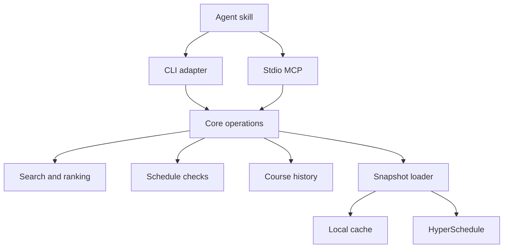

# 5C Index review and cleanup plan

Reviewed 2026-09-27. Scope: whole repo. Architecture, agent UX, human UX, dead code, unnecessary complexity, test quality. This pass changed only this file.

Direction recorded at review time: the local CLI and stdio MCP are the supported interface. The Cloudflare Worker and the HTTP MCP transport stay experimental; their findings are collected in the last section so they don't block local work.

Work this file top to bottom. P1 first. For each finding, write the acceptance test first, then fix until it passes.

## Judgment

The shape of the project is right and should not be rebuilt. One core engine, thin CLI and MCP adapters over it, five read-only MCP tools, a local snapshot cache with honest `fetched_at` provenance, MiniSearch for full text, and a skill that routes agents to the right tool. The FTS5 spike's own conclusion is correct: at ~2.2k docs MiniSearch is fast and free typo tolerance is worth more than FTS5 speed. Keep it. Do not add vectors, embeddings, another database, or a browser fallback.

The real problem is that several functions answer with confidence when the honest answer is an error, an ambiguity, or an incomplete result. An agent that calls `get_classes` today can be told everything resolved when one ID was garbage, and `check_schedule` will then certify a one-class "schedule" as OK. Every P1 finding below is that pattern in a different costume. Fix these before any polish, because they corrupt the answers the whole product exists to give.

Second problem: the adapters are not thin. Validation, fallback-message archaeology, suggestion lookup, synthetic schedule blocks, and a hand-maintained schema catalog all live in the CLI and MCP packages instead of core. The README's claim that "ALL logic lives in core" is aspirational. Move the shared logic into core and the adapters shrink for free.

Third problem: docs and tests enforce some of the wrong behavior. The skill references a renamed flag, a `level` filter that doesn't exist, and a 24h staleness rule that contradicts the 60s seat TTL. The e2e suite hardcodes the current term and asserts live seat counts. Typecheck and lint are green while the reproduced bugs exist, which means the tested contracts are not the real ones.

## Target architecture

- Core owns input validation, ID resolution, availability policy, error codes, and provenance. If both adapters need it, or an agent could be misled without it, it belongs in core.
- Adapters parse transport input, render results, and do nothing else. No validation beyond transport shape, no suggestion computation, no policy decisions.
- Inject what actually varies: `fetch`, cache location, and (where it matters for tests) the clock. Do not introduce a provider plugin system; there is one search engine and one upstream source.
- The worker is not in this diagram. It is a separate experiment, not a dependency of the supported path.

## P1. Answers that must be true

### 1. getClasses can report a garbage ID as resolved

**Evidence.** `packages/core/src/index.ts:293-302`. After resolution, an input is only pushed to `not_found` when no returned class shares its department or number. Both fields are undefined for garbage input, so `!parsed.dept` makes every returned class match. Reproduced: `getClasses(["CSCI 005 HM-01 FA2026", "totally invalid input"])` returns `not_found: []`. Reproduced downstream: `checkScheduleByIds` with one valid plus one garbage ID returns `class_count: 1` and a normal verdict.

**Failure.** An agent asks "can I take A and B?", B is a typo, and the tool answers about A alone and says OK.

**Fix.** Resolve each input independently. Every input must map to either a section, a candidate list, or `not_found`. Success on one input never implies resolution of another.

**Test.** Mixed valid plus garbage ID returns the garbage ID in `not_found`. `checkScheduleByIds` with any unresolved ID throws `E_NOT_FOUND` naming it, as it already claims to.

### 2. Loose IDs silently pick the first section, and cross-term handling is wrong

**Evidence.** `packages/core/src/index.ts:241-305`. `find` takes the first alias match with no ambiguity detection. `ids.slice(0, 20)` silently truncates. The alias predicate at line 288 compares the section against the loop's term, not the input's term, and `!parsed.term` lets a term-less ID match sections in every term being scanned. `fetched_at`/`stale` at lines 253-267 are overwritten by whichever term loaded last, so multi-term results carry the wrong provenance.

**Failure.** "CSCI 158" resolves to section 01 when the user meant 02, with no hint. A check with 25 IDs audits 20 with no warning. Two IDs from different terms each claim the other's snapshot time.

**Fix.** One resolution pass producing a per-input map. Loose input resolves only when it is unique; multiple matches return candidates instead of a silent first pick. Reject batches over the cap with `E_USAGE` instead of slicing. Carry provenance per term (list of `{term, fetched_at, stale}`).

**Test.** A code with two sections returns both as candidates with an ambiguity marker. A 25-ID check exits 2. A two-term get reports each term's own snapshot time.

### 3. An unavailable term silently becomes a different term

**Evidence.** `packages/core/src/index.ts:111-130` (`withTermFallback`) applied by search, get, check, and history. The fallback picks the newest available term and attaches a warning. The skill and `ids-and-terms.md` document this as intended behavior.

**Failure.** "What's offered in SP2027?" gets answered with FA2026 data plus a warning string an agent can miss or drop. A schedule "verified" against the wrong term is worse than no verification.

**Fix.** Default: `E_TERM_NOT_FOUND` listing available terms, so the agent states which term it will actually search. Offer explicit opt-in fallback (a core option plus a CLI `--fallback-term` style flag) for interactive browse. Update the skill, `ids-and-terms.md`, `troubleshooting.md`, and e2e expectations in the same change, since they currently teach the fallback.

**Test.** Search with an unpublished term exits 2 with `E_TERM_NOT_FOUND` and lists available terms. With the explicit opt-in, it falls back and warns. All four entry points behave identically.

### 4. Open-seat filtering contradicts the "trust status" contract

**Evidence.** `packages/core/src/filters.ts:196` (`openOnly` uses `seats.available > 0` arithmetic). `packages/core/src/conflicts.ts:181-186` reports `available <= 0` as "Closed: 0 open" regardless of registrar status. `packages/mcp/src/server.ts` tool descriptions tell agents to trust status, not seat arithmetic. Reproduced: a section with status C and 3 computed open seats passes `--open`.

**Failure.** `availability: "has_seat"` returns closed sections. A closed-but-under-capacity course is presented as enrollable.

**Fix.** One availability policy in core, used by filtering, schedule checks, and ranking identically: registrable means status O or R; capacity is always reported separately and never equated with eligibility. Over-enrolled-but-open sections read "no remaining capacity (status O)", not "Closed". `openOnly` should require registrable status; keep the capacity number visible everywhere. Verify against registrar docs what R and permCount actually allow before shipping, and note it in the skill.

**Test.** A closed section with spare capacity never passes `--open`. `check_schedule` on an over-enrolled open section reports a capacity problem with correct status wording.

### 5. Time-window filters can be satisfied by different meetings

**Evidence.** `packages/core/src/filters.ts:171-184`. Day membership, `afterMin`, and `beforeMin` are each checked independently with `.some()`. Reproduced: a section with a 9:00-10:00 block and a 14:00-15:00 block passes `--after 13:00 --before 11:00`, a window that contains no class time.

**Failure.** "Afternoons only" returns classes that also meet at 9am. An inverted window returns results at all.

**Fix.** Define the filter over the whole meeting set and document it: either every meeting must fit the window (recommended default for schedule building) or, if a discovery mode is wanted, make it a separate explicit mode. Reject inverted ranges as `E_BAD_FILTER`. State the semantics in the skill and `search-syntax.md`.

**Test.** The split-block section fails the inverted window and fails "all meetings in window". The error case for an inverted window exits 2.

### 6. Search pre-passes throw away valid results

**Evidence.** `packages/core/src/search.ts:112-182`. Exact-code, code-prefix, dept, browse, and title-phrase pre-passes each `return` early over their own candidate list. The title-phrase pre-pass runs before full-text and ignores filters until `finalize`. Reproduced: query "genetics" with `schools: ["HM"]` returns zero hits even though an HM section's description says Genetics, because the PO title match preempted retrieval.

**Failure.** Any filter narrower than the pre-pass silently deletes matching sections. Recall becomes an accident of which pre-pass fires.

**Fix.** Pre-passes should contribute candidates and scores to one retrieval pipeline; filters apply once over the union, then ranking decides. Keep strict exact-code identity (a full unambiguous code that matches nothing stays empty, no fuzzy soup). Remove the corpus-size caps (200 prefix, 60 title-phrase, 400 dept) as behavior switches; filter first instead.

**Test.** "genetics" plus `schools: ["HM"]` returns the HM description match. "CSCI 005" still exact-matches first. "QQQ 000" still returns zero.

### 7. Conflict exclusion ignores unknown anchor IDs

**Evidence.** `packages/core/src/index.ts:201-203` with `resolveIds` at `packages/core/src/index.ts:623-629`. Unknown anchor IDs are silently dropped. Reproduced: `excludeConflictsWith: ["MISSING"]` returns the full unfiltered result set.

**Failure.** "CS classes that don't clash with my MATH 19 section" silently returns everything, including clashing ones, if the anchor ID was mistyped.

**Fix.** Resolve anchors with the same strict per-input resolver from finding 1. Unknown, ambiguous, or wrong-term anchors are `E_NOT_FOUND`/`E_USAGE`, not a no-op.

**Test.** A bogus anchor exits with an error naming it. A valid anchor still drops overlapping hits (existing e2e case stays green).

### 8. check_schedule can certify an unauditable schedule as OK

**Evidence.** `packages/core/src/conflicts.ts:50-59` skips TBA sections with a warning, but `ok` at line 195 only reflects hard conflicts and seat problems, so TBA yields `ok: true`. `packages/mcp/src/server.ts:398-420`: the MCP text says "OK: no hard conflicts, all sections have seats" and never prints the general `warnings` array. The skill teaches "TBA sections never conflict", which agents will read as "TBA is safe".

**Failure.** A schedule containing a TBA section is presented as verified. A human reads a confident OK on a schedule that was only partially checked.

**Fix.** Add completeness to `CheckResult`: `complete: boolean` plus a list of skipped/unknown-time sections and data-quality issues. When incomplete, the text verdict must say so, and `ok: true` must read as "no conflicts found among sections with known times". Both text and structured output include all warnings. State explicitly that prerequisites and eligibility are never checked.

**Test.** A schedule with a TBA section returns `complete: false`, and the MCP text mentions the skipped section. `ok` alone never implies a complete audit.

### 9. Credit totals mix incompatible unit systems

**Evidence.** `packages/core/src/normalize.ts:460` copies `raw.credits` uninterpreted. `packages/core/src/conflicts.ts:187-192` sums them and advises against a universal "typical 3-5" range. The fixture already contains HM courses worth 3 and 4 and other colleges' courses worth 0.5 and 1. A 3-credit HM course and a 1-credit PO course are probably both "one course", but nothing in the repo establishes that.

**Failure.** A normal Mudd load (say 4 courses x 4 credits) triggers "Heavy load: 16 credits". Agents quote cross-college totals as if they were comparable.

**Fix.** First a verification task: confirm with registrar/HyperSchedule docs what `credits` means per college. Until then: preserve raw values, label totals as raw sums with mixed units, and suppress the heavy/light advice. If a conversion is later verified, add it as an explicit display layer, never in the stored value.

**Test.** Two HM sections sum to 7 raw credits with no "Heavy load" warning. Totals always render with the unit caveat until conversion is verified.

### 10. Course history can describe a different college's course

**Evidence.** `packages/core/src/history.ts:44-65`. The entry match checks dept, number, suffix, and the optional campus filter, but ignores a school embedded in the query. Reproduced: `getCourseHistory("CSCI 005 PO")` returns the HM history with HM instructors and campus HM. Enrichment at lines 83-95 joins on dept and number only, so any campus's sections can enrich the result. The `match.sort` by longest terms list picks "the course with the most history", not "the course asked about".

**Failure.** "How often is CSCI 5 offered at Pomona?" is answered with Mudd's history.

**Fix.** Resolve a full course identity (dept, number, suffix, and school when given) before matching. When the query under-specifies and multiple affiliations exist, return per-affiliation results or candidates, the same rule as finding 1. Enrichment joins on the same identity.

**Test.** "CSCI 005 PO" returns PO history only, or an explicit "not offered at PO, HM history exists" verdict. Never silent substitution.

### 11. History verdicts overstate the evidence

**Evidence.** `packages/core/src/history.ts:106-140`. "Fall-only course" is asserted from whatever terms the entry happens to list. "most often by X" is computed from sections of the current snapshot, not historical instructor data. `packages/core/src/index.ts:400-404` stamps history results with the sections snapshot's freshness while the history entries have their own fetch time. The fallback probe at lines 415-455 reads at most a handful of other terms' history files, so absence of evidence becomes "not offered".

**Failure.** A two-term window produces "Fall-only" with no stated window. The agent repeats a rotation claim the data doesn't support.

**Fix.** Report the observation window (earliest to latest term actually read), per-source freshness (sections vs history), and phrase verdicts from observed data: "Offered FA 2025 and FA 2026 in available history; no spring terms in window." Drop "most often by" or label it as current-snapshot-only. Say explicitly when the window is too short to imply a pattern.

**Test.** A short window never emits an unqualified cadence verdict. History freshness is reported separately from sections freshness.

### 12. Fetch timeouts stop at headers, so bodies can hang forever

**Evidence.** `packages/core/src/hyperschedule.ts:54,82` clears the abort timer when response headers arrive, before `json()`/`text()` consume the body. The worker copy has the same flaw (`worker/src/upstream.ts:119,146-156`). Single-flight dedup means all coalesced callers wait on the stalled request.

**Failure.** HyperSchedule sends headers then stalls; every CLI call hangs until the OS gives up, and the MCP server's shared cache makes it worse.

**Fix.** Keep the deadline active through body consumption; clear it in `finally`. Bound the retry-drain path too. Apply the same fix in the worker before hosting is ever enabled.

**Test.** A mocked response that resolves headers and stalls the body fails within the configured timeout, and the next call recovers rather than inheriting the stuck single-flight entry.

### 13. A broken ingest can replace a good catalog with a fragment

**Evidence.** `packages/core/src/cache.ts:465-517`. Quarantine only refuses a snapshot when zero usable rows survive. A schema drift that kills 2,000 of 2,188 rows leaves one section replacing the last-good 2,188, marked fresh, and the new meta count hides the drop.

**Failure.** Every search silently returns one class, and seats for the other 2,187 are presented as "not offered this term".

**Fix.** Add ingest acceptance rules: refuse the swap when the quarantine ratio or the count drop versus last-good exceeds a threshold; keep last-good with a loud error and surfaced counts. Expose `quarantined` through to CLI and MCP outputs whenever nonzero, so a successful search never hides partial ingest.

**Test.** A mostly-invalid refresh leaves last-good intact and reports quarantine counts. Meta files and in-process caches reflect the refusal.

## P2. Correctness and UX cleanup

### 14. Term ordering is wrong in two places, and the default term guess is silent

**Evidence.** `packages/core/src/index.ts:352` sorts term codes lexicographically on the current-term-lookup failure path, so "SP2025" outranks "FA2026". `packages/core/src/history.ts:83-85` sorts `${year}${term}` strings, putting SP2026 before FA2026 (reproduced). `packages/core/src/index.ts:486` silently falls back to hardcoded "FA2026" when everything else fails.

**Fix.** One chronological comparator used everywhere (`year`, then SU < SP < FA within a year for recency, or the reverse for listing; pick one and document it). If the current term can't be determined, error or warn rather than silently serving a stale hardcoded guess.

**Test.** Mixed-year term lists order correctly on both paths. History listings are chronological with FA before SP in the same year.

### 15. `--code` prefix behavior contradicts its own documentation

**Evidence.** `packages/cli/src/index.ts` help and `search-syntax.md` say `'CSCI 05'` matches CSCI 050-059. `packages/core/src/index.ts:182-188` pads the parsed number, producing prefix `CSCI005`, which matches only 005 (reproduced). The search pre-pass prefix path at `packages/core/src/search.ts:131-141` ignores parsed school and suffix.

**Fix.** Match prefix digits against the zero-padded number as typed: "CSCI 5" is exact number 5, "CSCI 05" is the 050-059 family, "CSCI 051" is exact. Honor school and suffix constraints on the prefix path. Document the digit rules in the skill.

**Test.** `--code "CSCI 05"` returns the 050s and not 005. `"CSCI 051 PO"` respects the school.

### 16. Validation happens after fetch, and number parsing accepts garbage

**Evidence.** Search loads the term before filters are validated, so `--days XX` costs a network round trip before exit 2. `Number.parseInt` at `packages/cli/src/index.ts:452-453` accepts `--limit 2junk` as 2. Limits and caps differ per command (`packages/cli/src/index.ts:1052,1109` default 6 with `|| 6` fallback). `refresh` skips term normalization entirely. Batch caps differ between core (silent slice) and MCP (schema max).

**Fix.** Validate all input before any fetch. One shared bounded-integer helper. Reject non-numeric numerics. Normalize terms everywhere, including refresh. One batch cap enforced in core.

**Test.** Bad filter values exit 2 with zero network calls (assert via fetch counter). `--limit 2junk` exits 2. `refresh --term blarg` exits 2 with `E_BAD_TERM`, not a network 404.

### 17. Normalizers accept nonsense quietly

**Evidence.** `packages/core/src/normalize.ts:219-231`: `FA123` parses as a term (three-digit year, reproduced). `normalizeDays` at lines 289-290 turns numeric-only input like "123" into an empty day filter, meaning "no constraint" (reproduced). Department normalization at `packages/core/src/filters.ts:73` strips invalid characters, so "C-S-I" silently becomes "CSI".

**Fix.** Terms accept 2 or 4 digit years only. Day input that parses to nothing is `E_BAD_FILTER`, distinct from the documented `ANY` alias. Department codes with invalid characters are rejected, not laundered.

**Test.** `FA123`, `--days 123`, and `--dept C-S-I` all exit 2 with a hint.

### 18. Overlap math exists twice, and mixed-term schedules aren't caught

**Evidence.** `packages/core/src/index.ts:632-657` (`conflictsWith`) duplicates `meetingsOverlap`/date logic from `packages/core/src/conflicts.ts:23-41`. Date gating only applies when a `half` marker exists. Travel warnings ignore date overlap. Nothing rejects a schedule spanning two terms.

**Fix.** One shared interval/date-overlap module used by conflicts, exclusion filtering, and travel. Detect duplicate sections and mixed terms in `checkSchedule` and flag them as data problems.

**Test.** Two sections from different terms produce a warning, not a silent comparison. Half-term sections with disjoint dates never conflict, in all three call sites.

### 19. CLI check builds fake courses for ad-hoc blocks and fetches twice

**Evidence.** `packages/cli/src/index.ts:706-770` fabricates a full `Section` for `--block`, with 1970-01-01 dates, invented seats, and school "BLOCK", then feeds it to the same math as real sections. The command also resolves IDs twice (`checkScheduleByIds` at line 938, `getClasses` again at line 949).

**Fix.** Give schedule blocks a small explicit type used by conflict math, or a clearly-marked synthetic variant. Parse blocks before any data load so usage errors exit 2 before network. Resolve IDs once and reuse.

**Test.** A malformed block exits 2 with no fetch. The combined check reports the block in `checked` and against real sections' date ranges.

### 20. Travel warnings pose as facts

**Evidence.** `packages/core/src/conflicts.ts:11-20` hardcodes a walking-time matrix keyed by school affiliation, unsourced, applied even when real locations are known or absent. `weekly_grid` at line 152 renders only M-F, so weekend classes vanish from the grid the agent quotes.

**Fix.** Keep the estimate but label it as approximate, keyed on real locations when both are known (same building means no travel risk), affiliation otherwise. Include S/U in the grid. Do not add a maps dependency.

**Test.** Travel messages say "about N min". A Saturday class appears in the grid.

### 21. Compact hits invent a meeting pattern

**Evidence.** `packages/core/src/search.ts:297-326` merges all meetings into one days string plus earliest start and latest end. A class meeting T 9:00 and R 14:00 displays as "TR 9:00-14:00".

**Fix.** Return the real meeting blocks in the hit (small array), keep the merged string only as a labeled summary if it earns its tokens. Add `credits` and a `potential_error`-style flag to hits so shortlisting doesn't require a detail call per candidate.

**Test.** A two-block section renders both blocks truthfully in JSON and TTY.

### 22. Staleness is visible in JSON and invisible to humans

**Evidence.** The `stale` flag exists end to end, but CLI TTY output and several MCP text paths print only the as-of timestamp. `troubleshooting.md` tells agents to warn only after 24h, while the seat TTL is 60 seconds and core already computes the flag. `fetched_at` is cache-retrieval time, not source-update time, and nothing says so.

**Fix.** Every rendering path (TTY, MCP text, skill guidance) uses the returned `stale` flag, not a local clock heuristic. Document what `fetched_at` means. Pagination should expose snapshot identity so a mid-page refresh is detectable.

**Test.** A stale snapshot prints a stale warning in TTY mode and in MCP text. Skill doc's threshold matches the flag.

### 23. CLI human-mode discovery and recovery are thin

**Evidence.** TTY search drops `suggestions` and pagination hints (JSON-only). An offset past the end prints "No results", indistinguishable from true empties. The `version` command at `packages/cli/src/index.ts:1518-1546` fetches course data just to report freshness, so it fails offline. Every error is marked `retryable: false`, including transient fetches, and every unexpected exception becomes `E_FETCH`.

**Fix.** TTY output gets the same guidance JSON gets. Offset-beyond-end says so with the total. Version stays offline (report last cached freshness only if a cache read succeeds, never a fetch). Retryability and error codes reflect the actual failure class.

**Test.** Offset past end prints the total and a correction hint. `5c version` works with the network down.

### 24. The MCP result contract is untested and partly wrong

**Evidence.** No tool declares an `outputSchema`; nothing tests a text-only client (no `structuredContent`), which is what many hosts show first. `openWorldHint: false` at `packages/mcp/src/server.ts:39` is inaccurate; every tool fetches an external upstream. Importing the server module starts it (`main()` runs at import, line 631).

**Fix.** Declare output schemas so structured results are validated. Add contract tests for both text and structured paths. Set `openWorldHint: true` (read-only, but it does touch the network). Guard `main()` behind an "executed directly" check so tests can import the factory.

**Test.** tools/list shows outputSchema per tool. Importing the module in a test does not open stdio. Text output of each tool is asserted on content, not just presence.

### 25. The skill and references have drifted from the code

**Evidence.** `SKILL.md` tells agents to read `potential_error`, but tool output exposes `potentialError`. `search-syntax.md` lists CLI flag `--no-conflict-with` for `exclude_conflicts_with`; the real flag is `--exclude-conflicts-with` (e2e even has a check named "exclusion flag renamed"). Recipe 2 suggests a `level` filter that doesn't exist. `search-syntax.md` says empty query "needs >=1 filter"; the implementation happily browses with none. Areas are called GE codes without college-specific applicability. Nothing explains that absent prerequisite text means unknown prerequisites, not none.

**Fix.** Regenerate the references from actual behavior after the P1 fixes land. Add the recommendation flow the skill lacks: preserve hard constraints, label any relaxation, distinguish course vs section vs lab when suggesting, never rank by quality. State the browse rule, whichever way finding 5's semantics land.

**Test.** A doc-lint script (or test) that flags/CLI names and field names in the skill exist in the built tool output. Evals updated to the corrected contracts.

### 26. Installation doesn't survive contact with a machine that isn't this checkout

**Evidence.** README's install line still says `npx skills add <owner>/5C-Index`. `.mcp.json` points at `./packages/mcp/dist/server.js`, which only works when the host's cwd is the repo root and dist has been built. No package declares a Node engine range. No test installs from a clean directory.

**Fix.** Pick supported Node versions and declare `engines`. Real install docs for CLI (npm link or pack) and MCP (absolute path in the host's config), with the skill installed separately. A clean-checkout smoke test that builds, installs to a temp prefix, and runs `5c version` offline.

**Test.** CI or a script performs the clean-install smoke and fails if it can't run offline.

### 27. Source coverage claims are unverified, and ID collisions are undetected

**Evidence.** The README says "ALL" 5C classes via HyperSchedule without recording what HyperSchedule actually covers (cross-registration programs, CG, joint affiliations, half-semester identity). The canonical ID format at `packages/core/src/normalize.ts:133` omits `half`, so two half-semester sections with identical dept/number/school/section could collide; nothing detects duplicate IDs at ingest.

**Fix.** Verification task, not a rewrite: document HyperSchedule's actual coverage and gaps in the skill, soften "all classes" claims to what's verified, and add duplicate-ID detection at ingest that flags or quarantines rather than silently overwriting. Keep affiliation (code origin), location (where it meets), and eligibility (who may register) as distinct facts in docs.

**Test.** Ingest of a synthetic duplicate ID is reported. Coverage notes in the skill cite their source and date.

## Simplification list

Things to delete or fold, after the P1/P2 contracts are stable. Check references before deleting each.

- `SearchProvider.load()` only throws, and `toJSON()` has no caller in production. Drop both from the interface; keep the serialization idea archived in the FTS5 spike. One engine means the provider seam is hypothetical.
- `Doc.codeFlat` is built per section but never searched or stored (`packages/core/src/search.ts:20,31`).
- The provider cache stores a `hash` field nobody reads (`packages/core/src/index.ts:58-84`).
- `searchClasses` stamps `fetched_at`/`stale` onto hits that `paginate` immediately overwrites.
- Seat/status score adjustments happen in both the pre-passes and `finalize`. Apply once, in one place, and delete the corpus-size caps that change query meaning.
- CLI `fallbackWarning` carries a legacy result-shape branch for a version that no longer exists.
- MCP `struct()` round-trips every result through JSON to satisfy a type bound; a typed cast or the SDK's generic will do.
- MCP history handler's `hf` double-cast exists only because `HistoryResult` doesn't declare fallback fields. Fix the type.
- CLI `schema` command is a ~250-line hand-maintained catalog duplicating Commander definitions and hit fields. Derive it from the command definitions and types.
- CLI `KNOWN_FLAGS` and `guardFlagSwallow` re-derive Commander's own knowledge; keep the behavior, derive the list.
- `parseBlock` and `toCompactHit` re-implement `minToStr`/`minTo12` locally.
- `suggestIds`'s title-contains-ID line matches nothing in practice; suggestion logic belongs in core behind one function used by both adapters (also deletes MCP's duplicate school-normalization bridge, `canonSchools`).
- `suggestIds`'s title check (`s.title.toLowerCase().includes(id.toLowerCase())`) can never usefully fire for full IDs.
- `listTerms` can return `limit + 1` items after unshifting the current term.
- Two `await import("./hyperschedule.js")` dynamic imports inside functions that could be static.
- Core re-exports every internal module (`export * from "./cache.js"` and friends), so the public interface is the whole implementation. Export only what adapters use.
- Zod appears twice, major version 4 in core and 3 in MCP. Reconcile based on SDK compatibility, not aesthetics.
- e2e has a duplicated MCP tools/list block and a per-checkout `mkdtemp` cache that is never cleaned up.
- CLI is one 1,500-line file. Split by command and by rendering; that is file organization, not a framework.
- The worker's unused KV "lock" (`worker/src/coalesce.ts:40-59`) is dead and nonexclusive; delete it when worker work resumes.

## Test plan

What currently passes tells us little: typecheck, lint, and the existing suites are green while every reproduced bug exists.

- Deterministic core regressions for findings 1-13, driven through the public core API with mock fetch and temp cache dirs (the reliability test suite already has the harness for this).
- Real CLI and MCP contract tests. Both packages run `vitest --passWithNoTests`, meaning zero tests. Test the JSON envelope, exit codes, text modes, and MCP text + structured output.
- Split live-network checks (current-term assertions, seat-dependent rankings, `refresh` against the real API) into an explicitly network-labeled suite. `tests/e2e.mjs` currently hardcodes FA2026 as current, assumes SP2027 is unpublished, and pins live seat rankings in `tests/evals/relevance-50.json`, which drift every add/drop.
- Replace sleep-based MCP sequencing and the fixed HTTP port with protocol-aware clients, readiness waits, and guaranteed cleanup.
- Replace vacuous assertions (the `Array.isArray` conflict checks in `core.test.ts`, `.every` over possibly-empty arrays) with exact expected outcomes.
- Move timing assertions out of correctness tests.
- Make the skill's `tool-paths.json` executable evaluations, not a shape check. Today's e2e verifies the JSON parses and IDs are sequential. Some expected paths are also wrong: detail tools before ID resolution, "next semester" always spring, TBA treated as no-conflict evidence.
- One release gate: clean build, typecheck, lint, unit, contract, and offline smoke in a single `pnpm` script.

## Deferred: hosting findings

The worker is a separate implementation, absent from the workspace, with its own fetch/cache code. The CLI and MCP call HyperSchedule directly. Until hosting is a requirement, treat the worker as an experiment. Do not delete it; do not wire it in.

Fixes required before anything hosted is trusted:

- `worker/src/index.ts:223-233`: a matching ETag returns 304 before any freshness check, so a stale snapshot can be revalidated forever; freshness rides entirely on cron.
- `worker/src/store.ts:104-137`: R2 bodies and KV metadata are separate eventually-consistent stores with no hash or version verification on read; clients can receive a body with another version's ETag, or a bogus 304. Store the authoritative body and metadata together in R2, treat KV as cache.
- `worker/src/index.ts:148-160` and `prewarm.ts:98-104`: any HTTP 200 body becomes the fresh snapshot; no term, shape, or count validation, no last-good preservation.
- `worker/src/index.ts:121-135` and `prewarm.ts:81-96`: metadata-only entries (missing R2 body) can 304 forever and never self-heal. Fetch unconditionally when the body is absent or invalid.
- `worker/src/upstream.ts:119,146-156`: same header-scoped timeout bug as core (finding 12).
- `worker/src/prewarm.ts:44-70`: lexicographic term fallback (SP2025 beats FA2026) and a hardcoded FA2026 when lookup fails.
- `worker/wrangler.toml:13,20`: KV namespace placeholder and a manually pinned current term block deployment.
- `worker/test/smoke.mjs:30,40-47,144-146`: the smoke test depends on an external `/tmp` fixture, so it can't run from a clean checkout, and the fake R2 bakes in the assumption that upstream ETags are writable via R2 put options (`store.ts:40-44`); verify against real Cloudflare types.
- `worker/src/envelope.ts:28-33,57-67`: CORS doesn't expose the freshness headers the docs advertise, and `Last-Modified` isn't an HTTP date.
- The upstream breaker only gates one route; cron and term-catalog calls keep hitting a down upstream.
- MCP `--http` (`packages/mcp/src/server.ts:578-627`): binds all interfaces, buffers unbounded request bodies, no host/origin policy, no per-request cleanup. Public data doesn't make it safe to expose; before supporting it, bind localhost by default, cap payload size, and add lifecycle tests.

## Implementation order

1. Write the failing deterministic tests for findings 1-13 (ID resolution, term behavior, availability, schedule completeness, filtered recall, history identity, ingest acceptance).
2. Fix the core contracts those tests expose. Do the two verification tasks (credit units, HyperSchedule coverage) in parallel.
3. Simplify the adapters around the corrected contracts, moving shared logic into core, and align text, JSON, and skill behavior in the same pass.
4. Installation reality: engines, docs, clean-checkout smoke.
5. Delete dead code and the hypothetical seams, after reference checks.
6. Revisit hosting only when a hosted requirement actually returns, and start from the deferred list above.

## What was validated in this review

- TypeScript `--noEmit` passed for core, CLI, and MCP. Biome checked 42 files with no findings.
- Read-only in-memory probes (no filesystem writes, no network) reproduced: swallowed unknown IDs, one-class "OK" audits, ignored conflict anchors, closed sections passing `--open`, impossible time windows passing, filtered-search false negatives, TBA schedules as `ok: true`, the `CSCI 05` prefix miss, `FA123` accepted, numeric days as empty filter, history campus substitution, and SP-before-FA ordering.
- Fixture inspection confirmed mixed credit scales. Registrar unit semantics were not verified.
- The full test suite, build, live upstream comparison, deployment, and browser tests were not run; existing test commands write caches and start servers. e2e and eval claims in this file come from reading their code.

## Implementation status

Implemented against this file, then verified. Status as of 2026-09-27.

**Landed (findings 1-25 as far as the local distribution reaches):**

- Core contracts: per-input ID resolution with candidates instead of silent picks; `E_TERM_NOT_FOUND` by default with opt-in `--fallback-term` / `allow_term_fallback`; registrar-status availability in filters, ranking, and checks; whole-schedule time windows with inverted-range rejection; candidate-union search recall (no corpus caps); strict exclusion anchors; `complete` + `skipped_tba` on checks; honest history identity, per-campus verdicts, and observed-window phrasing; body-scoped fetch timeouts; ingest acceptance policy with `quarantined` / `duplicate_ids` surfaced through `SnapshotMeta` on search, get, and check.
- Adapters: CLI split into envelope/render/blocks with a derived schema catalog, offline `version`, ambiguity handling, single-ID checks, and one flag-swallow guard for every command; MCP rebuilt around one schema module (input + output schemas), pure text renderers, a shared error mapper, an import guard, `openWorldHint: true`, and a localhost-only body-capped HTTP transport.
- Shared test surface: `tests/fixture-server.mjs` is a fixture HyperSchedule upstream; `FIVE_C_API_BASE` lets any adapter point at it, so no suite needs the network.
- Tests: 90 core + 27 CLI + 19 MCP, all offline. e2e splits into an offline default (115 checks) and a `--live` network suite (119 checks) holding the relevance-50 top-1 set.
- Installation: `engines.node >= 20`, `files: ["dist"]`, core bundled into both adapters (no `workspace:*` at install time), and `pnpm smoke` packs, installs into a temp prefix, and runs the CLI offline plus an MCP handshake.
- Dead code: `SearchProvider.load`, `codeFlat`, the write-only provider hash, the legacy CLI fallback branch, MCP `struct()`/`canonSchools` duplication, and the hand-maintained schema catalog are gone.

**Deliberately not done:**

- Worker and hosting findings, per the scope decision above. The MCP `--http` transport was hardened (localhost default, 1 MiB body cap, real port logging) but stays experimental.
- Credit-unit verification (finding 9) remains an open question: the code now says "raw sum; units differ across colleges" instead of implying a comparable total. Confirming registrar unit semantics is still a research task.
- HyperSchedule coverage (finding 27) is documented from live inspection in `skills/5c-classes/references/ids-and-terms.md` with a source and date, not independently audited against every registrar page.
- `tool-paths.json` prompts are corrected where they encoded wrong contracts, but they remain prompts rather than executable evaluations; nothing here asserts what a model actually did.

**Validation run for this implementation:** `pnpm build`, `pnpm typecheck`, `pnpm lint` (54 files, clean), `pnpm test` (136 tests), `pnpm e2e` (offline, 115 checks), `pnpm e2e:live` (119 checks including relevance-50), `pnpm smoke` (clean install), `pnpm --filter 5c-core eval` (live smoke).

**Distribution (added after this review):** both adapters ship on npm as `@kainoa/5c-cli` and `@kainoa/5c-mcp` — scoped, because the registry's typosquat guard rejected unscoped `5c-cli` as too similar to `cp-cli`. Zero-install paths are live and verified against the registry: `npx @kainoa/5c-cli@latest` (CLI, bin `5c`) and `npx -y @kainoa/5c-mcp` (MCP host config). Releases run through `.github/workflows/publish.yml`: merge to `main` publishes exactly the packages whose `version` bumped, via npm trusted publishing (OIDC, no stored npm token), skipping versions already on npm. `5c-core` stays private and bundled. One bootstrap lesson is baked into `pnpm smoke`: bin values must be written normalized (no leading `./`) because npm's publish-time normalizer rewrites them — `npm pack` never shows this, and `npm publish --dry-run` is registry/auth-dependent and fails once a version exists, so the smoke check is an offline manifest lint instead.
